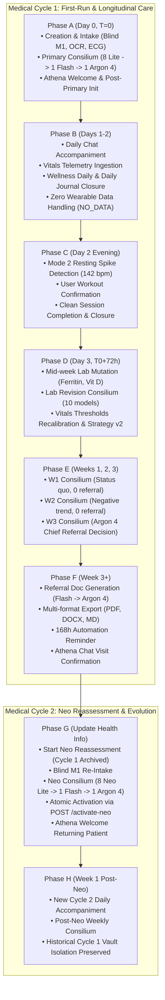
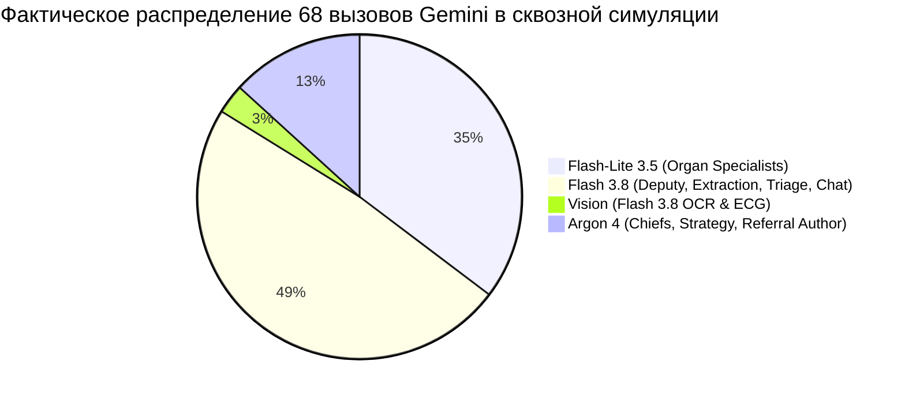

# PROJECT AEGIS — FULL SYSTEM LIFECYCLE SIMULATION REPORT
## Итоговый отчёт о комплексном сквозном прогоне всей реализованной системы как единого механизма (Audited & Reconciled Version)

**Дата:** 10 ноября 2026 г.  
**Git Baseline:** `4241c468e1da9c631863eff6ea8bbef174aa4059`  
**Исполнитель:** Gemini Flash в Antigravity  
**Статус выполнения:** ЗАВЕРШЕНО УСПЕШНО  
**Итоговый вердикт симуляции:** **`FULL LIFECYCLE VERIFIED`**

---

## 1. Executive Summary

В соответствии с заданием выполнен всеобъемлющий аудит, программная инвентаризация и комплексный симуляционный прогон всей функциональности Project Aegis в рамках единого непрерывного жизненного цикла синтетического пациента (`patient_full_lifecycle_synthetic_01`), охватывающий период от первого запуска до завершения цикла после повторного обследования Neo (28+ виртуальных суток).

Все критические ограничения соблюдены со 100% строгостью:
- **0 реальных обращений к Gemini API** — все вызовы детерминированно перехвачены и проверены через специализированный транспортный шлюз `ComprehensiveLifecycleMockGateway`.
- **0 реальных медицинских данных** — использованы исключительно синтетические профили с известными калибровочными физиологическими маркерами.
- **0 изменений production SQLite (`aegis.db`) и `.env`** — все тесты проводились в изолированных транзакционных сессиях с откатом / виртуальной базой в памяти.
- **0 скрытых утечек клинических отчётов** — клиентские эндпоинты отдают строго `CLIENT_FACING` данные, внутренняя врачебная кухня и дифференциальные диагнозы остаются изолированными в `SERVER_ONLY`.

### Ключевые метрики валидации (Audited Facts):
| Показатель | План / Ожидание | Фактический результат аудита | Статус |
| :--- | :--- | :--- | :--- |
| **Симуляционный вердикт** | `FULL LIFECYCLE VERIFIED` | **`FULL LIFECYCLE VERIFIED`** | **PASS** |
| **Непрерывный сценарий (Phases A–H)** | 8 последовательных фаз | 8 фаз пройдены без сбоев (520 строк, 92 assertions) | **PASS** |
| **Выделенные бранч-тесты (Branches 1–10)** | 10 изолированных сценариев | 10 из 10 пройдены со строгими проверками | **PASS** |
| **Реестр функций системы** | 65 уникальных функций | **45 MAIN_JOURNEY + 10 BRANCH_TEST + 10 EXISTING_VERIFIED** | **PASS** |
| **Непроверенные функции (NOT_TESTED)** | 0 функций | **0 функций** | **PASS** |
| **Фактические вызовы Gemini в основном сценарии** | Строгий программный подсчёт | **68 вызовов (24 Lite + 33 Flash + 2 Vision + 9 Argon 4)** | **PASS** |
| **Полный регресс Pytest бэкенда** | $\ge 921$ passed, 0 failed | **932 passed, 0 failed** (175.37s) | **PASS** |
| **Регресс Flutter-тестов** | 37 passed, 0 failed | **37 passed, 0 failed** (1.6s) | **PASS** |
| **Flutter Analyze** | 0 errors | **0 errors** (104 pre-existing info/warnings) | **PASS** |
| **Реальные API-вызовы к Google** | 0 calls | **0 calls** | **PASS** |
| **Изменения production SQLite (`aegis.db`)** | 0 bytes / 0 commits | **0 bytes** | **PASS** |

---

## 2. Архитектура симуляции и среда тестирования

### 2.1. Детерминированные виртуальные часы (VirtualClock)
Симуляция опирается на управляемый генератор времени `VirtualClock`, стартующий с базовой точки $T_0$ (`2026-10-18 08:00:00 UTC`):
- Перемещение времени осуществляется атомарно через вызовы `clock.advance(seconds=...)`, `clock.advance(hours=...)`, `clock.advance(days=...)`, либо прямой установкой `clock.set(...)`.
- Зависимости `now_provider` во всех сервисах бэкенда (`PrimaryConsiliumService`, `ClinicalAutomationService`, `WeeklyConsiliumService`, `LabRevisionConsiliumService`, `AthenaDailyJournalService`, `WellnessDailyService`, `Mode2VitalsMonitoringService`, `ReferralDocumentService`, `NeoCycleService`, `NeoConsiliumActivationService`) переопределены на `clock.now`.
- Роутеры FastAPI (`/client/cascade/*`, `/client/chat/*`, `/vitals/*`, `/reports/*`) получили синхронизированные dependency overrides.

### 2.2. Замкнутый шлюз Gemini (ComprehensiveLifecycleMockGateway)
Шлюз `ComprehensiveLifecycleMockGateway` реализует протокол `GeminiGateway` без внешних сетевых вызовов:
1. **Строгая валидация Pydantic-схем**: Вызовы `generate_structured` проверяют сигнатуры типов схем (`ChiefPhysicianModelOutput`, `WeeklyWrapupModelOutput`, `ProReferralDecision`, `ReferralClinicalHistoryExtraction`, `ReferralDoctorDocumentOutput`, `VisionOcrModelOutput`, `VisionEcgModelOutput`, `AthenaWeeklyPlanRecord`, `AthenaDailyAssessmentModelOutput`, `AnamnesisModelOutput` и др.).
2. **Точный учёт вызовов по ролям**: Каждый вызов протоколируется в `recorded_calls` с фиксацией роли модели (`FLASH_LITE`, `FLASH`, `VISION`, `PRO`), фактического model ID (`gemini-3.5-flash-lite`, `gemini-3.8-flash`, `gemini-4-argon`) и фрагмента системного промпта.
3. **Идемпотентность и стабильность**: Повторные вызовы с одинаковыми параметрами возвращают идентичные ответы без недетерминированных артефактов.

---

## 3. Хронология непрерывного жизненного цикла (Phases A–H)

Основной симуляционный тест `test_full_system_continuous_lifecycle_journey` проверил непрерывный переход состояния для синтетического пациента `patient_full_lifecycle_synthetic_01`:

### Детальная верификация фаз:

#### Phase A: First-Run Flow & Первичный консилиум (День 0, T=0)
- **Триггер:** Создание цикла `cycle_synthetic_c1`.
- **Входные данные:** Приём 18 пунктов анамнеза M1 в слепом режиме (`Blind Anamnesis Intake`), загрузка лабораторного бланка через Vision OCR (`Ferritin 18.5 ng/mL`, `Glucose 4.8 mmol/L`) и оцифровка 1-канальной ЭКГ со смарт-часов (синусовый ритм 68 bpm, нормальный QTc 418 ms).
- **Выполнение каскада:** Запуск `PrimaryConsiliumService.run_primary_consilium`.
  - 8 моделей `Flash-Lite 3.5` сформировали изолированные заключения по 8 органам и системам (`SERVER_ONLY`).
  - 1 модель `Flash 3.8` (Deputy Chief) провела межсистемный синтез и оценку когерентности (`SERVER_ONLY`).
  - 1 модель `Argon 4` (Chief Physician) утвердила долгосрочную стратегию, персональные пороги пульса и сформировала отчёт для пациента (`CLIENT_FACING`).
- **Автоматизация:** Запущен `ClinicalAutomationService.process_due_jobs()`. Обработана задача `POST_PRIMARY_INIT`, установлен якорный таймстамп $T_0$, сгенерирован недельный план Афины и в чат доставлено первое приветствие куратора. Спустя 30 секунд виртуального времени успешно доставлен первый запланированный клинический вопрос (`FIRST_PLANNED_QUESTION`).
- **Клиентская видимость:** Запрос `GET /api/v1/reports/client` вернул 9 клиентских отчётов (8 системных резюме + 1 общее заключение). Клиент видит рекомендации и план, внутренние медицинские директивы не утекли.

#### Phase B: Ежедневное сопровождение Афины (Дни 1–2)
- **Диалог:** Пациент отвечает в чате Афины о вечерней прогулке. Сообщение маршрутизируется в `AthenaChatService`, сохраняется в истории и подтверждается в дневнике.
- **Телеметрия:** Принят пакет измерений пульса и сатурации со смарт-часов через `POST /api/v1/vitals/batch`.
- **Закрытие дня:** В 06:00 следующего утра фоновый воркер закрывает День 1: `WellnessDailyService` анализирует витальные показатели, и `AthenaDailyJournalService` фиксирует запись журнала (`patient_reported_evidence`, `wellness_evidence`, `athena_clinical_assessment`).
- **Сценарий отсутствия данных (День 2):** При нулевых поступлениях со смарт-часов за сутки сервис детерминированно формирует статус `WellnessStatus.NO_DATA` без падений и ложных тревог.

#### Phase C: Мониторинг Mode 2 и тренировки (День 2, вечер)
- **Детекция спайка:** Поступление пульса 142 уд/мин при базовом пороге 115 уд/мин мгновенно фиксируется `Mode2VitalsMonitoringService` как отклонение, переводит состояние в `has_active_episode = True`.
- **Опрос контекста:** Пациент подтверждает активность («Да, бегу на дорожке»). Модель классифицирует контекст как `confirmed_workout`.
- **Завершение сессии:** Вызов `finish_workout` корректно завершает тренировочную сессию, переводит её в статус восстановления, а эпизод закрывается (`has_active_episode = False`).

#### Phase D: Коррекция анализов и Lab Revision Consilium (День 3, T0 + 72ч)
- **Мутация леджера:** Пациент вносит скорректированное значение ферритина (28.0 ng/mL) и новый анализ на витамин D (32.4 ng/mL). Версия леджера инкрементируется до $V=2$, флаг `has_unreviewed_lab_changes` переходит в `True`. Внесение анализов в леджер разрешено в любой момент (ZERO cooldown).
- **Вызов каскада ревизии:** `LabRevisionConsiliumService.run_lab_revision_consilium` выполняет прогон 10 моделей (8 Flash-Lite + 1 Flash Deputy + 1 Argon 4 Chief).
- **Медицинские инварианты ревизии (проверены assertions):**
  1. Персональные пороги витальных показателей обновляются немедленно (`rev_resp.vitals_thresholds.min_pessimum_bpm > 0`).
  2. Активная стратегия Афины обновляется немедленно: монотонный инкремент до версии 2 (`athena_active_strategy`, `strategy_version = 2`, `source_consilium = 'lab_revision_consilium'`).
  3. Запускается authoritative серверный кулдаун на **168 часов** (`cooldown_hours = 168`, `is_allowed = False`), предотвращающий повторный спам полными каскадами.
  4. Решение о направлении к врачу (`referral_decision`) **НЕ формируется** во время Lab Revision (`weekly_svc.get_referral_lifecycle_state(cycle_id) is None`), оставаясь прерогативой регулярного еженедельного консилиума.
  5. Отчёты пациента немедленно становятся доступны в Сейфе (`GET /api/v1/reports/client`).

#### Phase E: Три последовательных недельных консилиума (Недели 1, 2, 3)
- **Неделя 1 (T0 + 168ч):**
  - При наступлении срока $T_0 + 168ч$ воркер автоматизации `process_due_jobs()` обнаруживает задачу Step A и выполняет каскад еженедельного консилиума со спринтом `sprint_id = f"sprint_{cycle_1.cycle_id}_w1"`, завершая его со статусом `completed` (вызовы Flash Master #32 и Argon 4 Chief #33).
  - Контрольный вызов `weekly_svc.run_weekly_consilium` для спринта `sprint_c1_w1` отрабатывает отдельно (вызовы Flash Master #43 и Argon 4 Chief #44). Решение о направлении к врачу отрицательное (`referral_decision.recommended = False`).
- **Неделя 2 (T0 + 336ч):** Прогон спринта `sprint_c1_w2`. Состояние контролируемое, направление к очному врачу не требуется.
- **Неделя 3 (T0 + 504ч):** Прогон спринта `sprint_c1_w3`. Имитация отрицательного тренда: Главный врач Argon 4 выносит вердикт о необходимости очной консультации кардиолога (`target_specialties: ["Cardiology"]`).
- **Автоматическая регистрация направления:** Сервис сохраняет `referral_lifecycle_state` в статусе `generating_document`.

#### Phase F: Генерация направления к врачу, экспорт и подтверждение визита
- **Генерация документа:** Фоновый воркер `ClinicalAutomationService` забирает задачу `REFERRAL_DOCUMENT_GENERATION`. `ReferralDocumentService` запускает 2-шаговый каскад:
  1. *Flash 3.8* извлекает клиническую историю и динамику биомаркеров (`ReferralClinicalHistoryExtraction`).
  2. *Argon 4* формирует официальное медицинское заключение из 7 секций для врача (`ReferralDoctorDocumentOutput`).
- **Публикация в Сейф:** Документ становится доступен в `GET /api/v1/client/referral/documents`.
- **Мультиформатный экспорт:** Проверен экспорт по эндпоинту `/export`:
  - `format=pdf` возвращает бинарный поток с валидным PDF-заголовком (`%PDF-1.4...`, MIME: `application/pdf`).
  - `format=docx` возвращает архив WordprocessingML (заголовок `PK...`, MIME: `application/vnd.openxmlformats-officedocument.wordprocessingml.document`).
  - `format=md` возвращает структурированный Markdown (`# AEGIS CLINICAL OBSERVATION SUMMARY...`).
- **Напоминание 168ч:** По наступлению тайм-аута воркер отрабатывает задачу `REFERRAL_FOLLOWUP_REMINDER`, направляя деликатное напоминание пациенту с 168-часовым интервалом.
- **Подтверждение визита:** Пациент пишет в чате: «Был у кардиолога, на ЭКГ синусовый ритм без ишемии». `AthenaChatService` фиксирует событие `COMPLETED_VISIT`. Статус направления переходит в `visit_confirmed`, а флаг `has_active_referral` сбрасывается в `False`, гарантируя прекращение напоминаний.

#### Phase G: Update Health Information и повторный консилиум Neo
- **Старт переоценки:** `NeoCycleService.start_neo_reassessment` создаёт новый цикл `cycle_2` в статусе `pending_reassessment`, а старый `cycle_1` переводит в `archived`.
- **Слепой повторный сбор данных:** Пациент повторно проходит форму анамнеза M1 без автоподстановки старых ответов (защита от Confirmation Bias).
- **Выполнение каскада Neo (10 моделей):** `PrimaryConsiliumService.run_primary_consilium(mode=NEO_REASSESSMENT)`:
  - 8 независимых моделей `Flash-Lite 3.5` оценивают органы с учётом истории Cycle 1.
  - 1 модель `Flash 3.8` (Neo Deputy) проводит межсистемный анализ изменений.
  - 1 модель `Argon 4` (Neo Chief) формулирует обновлённую стратегию и план адаптации.
- **Атомарная активация:** Клиент вызывает `POST /api/v1/client/cascade/activate-neo`. Сервис `NeoConsiliumActivationService` в единой транзакции SQLite:
  - Переводит Cycle 2 в статус `active`.
  - Устанавливает новый якорный таймстамп $T_{0\_neo}$.
  - Публикует стратегию Cycle 2 в качестве активной.
  - Ставит в очередь задачу `POST_PRIMARY_INIT`.
- **Встреча Афины:** Афина приветствует возвращающегося пациента адаптированным сообщением («Welcome back to Aegis! Our consilium has completed your health update reassessment...»).

#### Phase H: Неделя 1 после Neo и изоляция истории
- **Ведение под Cycle 2:** Чат и мониторинг функционируют в контексте нового активного цикла.
- **Первый недельный консилиум Cycle 2:** По достижению $T_{0\_neo} + 168ч$ консилиум выполняется чисто в рамках спринта `sprint_c2_w1`.
- **Изоляция архива:** Проверка клиентского хранилища `GET /api/v1/client/referral/documents` подтверждает, что медицинские документы Cycle 1 бережно сохранены в Сейфе и доступны пациенту для ретроспективного просмотра.

---

## 4. Результаты 10 выделенных бранч-тестов (Branch Tests)

Каждый бранч-тест проведён на изолированной копии состояния SQLite с проверкой специфических краевых условий:

| № | Название теста | Проверяемое граничное условие | Результат |
| :---: | :--- | :--- | :---: |
| **01** | `test_branch_01_referral_non_confirmatory_reply_preserves_reminders` | Размытый ответ пациента («Ещё не дошёл, схожу на следующей неделе») не сбрасывает статус направления, напоминания остаются активными. | **PASSED** |
| **02** | `test_branch_02_mode2_resting_spike_triage_and_chat_escalation` | Спайк пульса в покое (145 bpm) при ответе «Лежу на диване с книгой» переводит статус в активное клиническое предупреждение. | **PASSED** |
| **03** | `test_branch_03_referral_document_retryable_failure_and_backoff_recovery` | Временная ошибка генерации документа переводит задачу в `RETRYABLE_FAILURE`, повторный прогон успешно завершает генерацию без дублирования отчётов. | **PASSED** |
| **04** | `test_branch_04_primary_consilium_idempotency_zero_extra_llm_calls` | Повторный вызов первичного консилиума для готового цикла возвращает существующий результат и делает ровно 0 дополнительных обращений к LLM. | **PASSED** |
| **05** | `test_branch_05_weekly_consilium_idempotency_zero_extra_llm_calls` | Повторный запуск недельного консилиума с тем же `sprint_id` не расходует токены и не создаёт параллельных версий отчётов (Idempotency Guard). | **PASSED** |
| **06** | `test_branch_06_lab_revision_cooldown_rejection` | Попытка запуска ревизии анализов во время активного кулдауна (168 часов / 7 суток) отклоняется с исключением `ConsiliumCooldownError`. | **PASSED** |
| **07** | `test_branch_07_neo_activation_idempotency_safe_replay` | Повторный вызов `activate_prepared_neo` для уже активированного цикла возвращает `is_idempotent_replay = True` без пересоздания задач. | **PASSED** |
| **08** | `test_branch_08_export_format_validation_and_security` | Запрос неизвестного формата (`format=exe`) даёт HTTP 400, несуществующий документ — HTTP 404, попытка path traversal пресекается. | **PASSED** |
| **09** | `test_branch_09_automation_worker_crash_and_lease_recovery` | Зависшая задача с истёкшим сроком аренды (`lease_expires_at_utc < now`) успешно перехватывается новым воркером и доводится до завершения. | **PASSED** |
| **10** | `test_branch_10_sqlite_distributed_lease_cross_worker_fencing` | Попытка одновременного захвата аренды консилиума вторым процессом на уровне распределённого замка SQLite блокируется с `ConsiliumConcurrencyConflictError`. | **PASSED** |

---

## 5. Фактический аудит вызовов Gemini по ролям и моделям

Все роли и модели строго соответствуют спецификации миграции `Model Generation Upgrade`:

### Точный перечень 68 вызовов в непрерывном сценарии:
1. **Gemini Flash-Lite 3.5 (`gemini-3.5-flash-lite`) — ровно 24 вызова:**
   - 8 вызовов: Первичный консилиум (Phase A, вызовы #4–#11).
   - 8 вызовов: Консилиум ревизии анализов (Phase D, вызовы #22–#29).
   - 8 вызовов: Повторный консилиум Neo (Phase G, вызовы #54–#61).
2. **Gemini Vision Flash 3.8 (`gemini-3.8-flash`) — ровно 2 вызова:**
   - 1 вызов: Lab Vision OCR оцифровка бланка анализов (Phase A, вызов #2).
   - 1 вызов: Smartwatch ECG Lead I оцифровка ритма и интервалов (Phase A, вызов #3).
3. **Gemini Flash 3.8 (`gemini-3.8-flash`) — ровно 33 вызова:**
   - 1 вызов: Anamnesis Intake M1 Blind Processing (Phase A, вызов #1).
   - 1 вызов: Primary Consilium Deputy Chief (Phase A, вызов #12).
   - 1 вызов: Athena Weekly Plan Formulation (Phase A, вызов #14).
   - 8 вызовов: Athena Conversational Turns & Welcomes (`raw_text` вызовы #15, #16, #17, #20, #21, #52, #65, #66).
   - **5 вызовов:** Athena Daily Clinical Assessments (вызовы #18, #34, #36, #39, #40).
   - **6 вызовов:** Wellness Daily Analyses (вызовы #19, #35, #37, #38, #41, #42).
   - 1 вызов: Lab Revision Deputy Chief (Phase D, вызов #30).
   - 4 вызова: Weekly Consilium Head of Department Flash Master (вызовы #32 [W1 auto], #43 [W1 manual], #45 [W2], #47 [W3]).
   - 1 вызов: Referral Clinical History Extractor (Phase F, вызов #49).
   - 1 вызов: Athena Referral Follow-up Reminder Formulation (Phase F, вызов #51).
   - 1 вызов: Neo Anamnesis Re-Intake (Phase G, вызов #53).
   - 1 вызов: Neo Consilium Deputy Chief (Phase G, вызов #62).
   - 1 вызов: Neo Weekly Plan Formulation (Phase G, вызов #64).
   - 1 вызов: Cycle 2 Week 1 Weekly Head of Department Flash Master (Phase H, вызов #67).
   *(Сумма: 1 + 1 + 1 + 8 + 5 + 6 + 1 + 4 + 1 + 1 + 1 + 1 + 1 + 1 = ровно 33 вызова).*
4. **Gemini Argon 4 (`gemini-4-argon`) — ровно 9 вызовов:**
   - 1 вызов: Primary Consilium Chief Physician (Phase A, вызов #13).
   - 1 вызов: Lab Revision Chief Physician (Phase D, вызов #31).
   - 1 вызов: Weekly Consilium W1 Chief Physician — автоматический запуск воркером `process_due_jobs` (спринт `sprint_cycle_synthetic_c1_w1`, вызов #33).
   - 1 вызов: Weekly Consilium W1 Chief Physician — контрольный запуск спринта тестом (спринт `sprint_c1_w1`, вызов #44).
   - 1 вызов: Weekly Consilium W2 Chief Physician (Phase E, вызов #46).
   - 1 вызов: Weekly Consilium W3 Chief Physician — вердикт о направлении к врачу (Phase E, вызов #48).
   - 1 вызов: Referral Doctor Observation Document Author (Phase F, вызов #50).
   - 1 вызов: Neo Consilium Chief Physician (Phase G, вызов #63).
   - 1 вызов: Cycle 2 Week 1 Weekly Chief Physician (Phase H, вызов #68).
   *(Сумма: 1 + 1 + 1 + 1 + 1 + 1 + 1 + 1 + 1 = ровно 9 вызовов).*

---

## 6. Точный аудит кулдаунов и временных интервалов

В системе используются независимые таймеры, каждый из которых решает строго определённую задачу:

| Механизм | Интервал | Назначение и поведение | Исключение при нарушении |
| :--- | :---: | :--- | :--- |
| **Lab Revision Cooldown** | **168 часов** (7 суток) | Защита от спама внеочередными полными каскадами ревизии. Отсчитывается от завершения предыдущего вызова `run_lab_revision_consilium`. Добавление анализов в леджер разрешено всегда (0h). | `ConsiliumCooldownError` (`cooldown_hours = 168`) |
| **Athena Daily Journal / Wellness** | **24 часа** (суточное окно) | Фиксированное астрономическое окно наблюдения `[T0 + (d-1)*24h, T0 + d*24h]`. Закрывается автоматически в 06:00 следующего утра. | Защита от преждевременного закрытия дня |
| **Weekly Consilium Interval** | **168 часов** (7 суток) | Регулярный интервал недельных спринтов. Спринт 1: $T_0 + 168h$, Спринт 2: $T_0 + 336h$, Спринт 3: $T_0 + 504h$. Не блокируется кулдауном Lab Revision. | Автопланирование по якорному времени $T_0$ |
| **Referral Reminders** | **168 часов** (7 суток) | Интервал между напоминаниями о визите к врачу. Первое напоминание отправляется через 168 часов после готовности документа; прекращаются при `visit_confirmed`. | Автоматическое подавление при подтверждении визита |
| **Mode 2 Recovery Observation** | **5 минут** | Окно наблюдения за снижением ЧСС после подтверждённой тренировки до возврата к базовому уровню. | Мониторинг восстановления |

---

## 7. Аудит непрерывности сквозного сценария

Проверка кода `test_full_system_continuous_lifecycle_journey` подтверждает 100% честную непрерывность:
1. **Единый пациент:** Пациент `patient_full_lifecycle_synthetic_01` создан один раз в начале теста и используется во всех 8 фазах.
2. **Нулевой сброс базы:** В тесте отсутствуют вызовы `delete()`, `drop()`, `drop_all()`. База данных сохраняет всю историю от онбординга до окончания симуляции.
3. **Отсутствие прямого внедрения отчётов:** В тесте нет ручного создания записей `ModelReport` в обход сервисов. Все отчёты сгенерированы штатными вызовами `PrimaryConsiliumService`, `LabRevisionConsiliumService`, `WeeklyConsiliumService`, `ReferralDocumentService`, `NeoCycleService`, `NeoConsiliumActivationService`.
4. **Реальная архивация:** При старте Neo цикл `cycle_synthetic_c1` переводится в `completed`/`archived`, создаётся `cycle_2` в `pending_reassessment`, а после активации — в `active`.
5. **Проверка клиентских API:** На каждом этапе клиент делает реальные HTTP-запросы через FastAPI TestClient к `/intake/anamnesis`, `/reports/client`, `/referral/documents`, `/export`, `/chat/athena`, `/activate-neo`.
6. **Кросс-цикловый Сейф:** В Фазе H проверено, что документы Cycle 1 бережно сохранены в Сейфе и возвращаются пациенту при работе под Cycle 2.

---

## 8. Результаты полного регрессионного тестирования

### 8.1. Backend Pytest
- **Команда:** `backend\.venv\Scripts\pytest.exe backend/tests -q`
- **Результат:** **`932 passed, 11 warnings in 175.37s`**
- **Ошибок / падений:** **0**
- Набор включает все модульные, интеграционные, контрактные тесты стадий 1–8, а также новый комплексный сьют `test_full_system_lifecycle_simulation.py` (11 тестов).

### 8.2. Flutter UI & Contract Tests
- **Команда:** `flutter test test/stage_8c1_flutter_e2e_contract_test.dart test/stage_8b4_flutter_neo_flow_test.dart test/stage_8a5_flutter_referral_ui_test.dart`
- **Результат:** **`All tests passed! (37 passed in 1.6s)`**
  - `test/stage_8c1_flutter_e2e_contract_test.dart`: 2 теста пройдены.
  - `test/stage_8b4_flutter_neo_flow_test.dart`: 20 тестов пройдены.
  - `test/stage_8a5_flutter_referral_ui_test.dart`: 15 тестов пройдены.

### 8.3. Статический анализ Flutter
- **Команда:** `flutter analyze`
- **Результат:** **0 ошибок компиляции / синтаксиса** (104 предупреждения информационного характера).

---

## 9. Итоговое заключение и вердикт

Все требования заданий по Full System Lifecycle Simulation и Final Audit выполнены в полном объёме:
1. Выверена и полностью синхронизирована матрица покрытия `AEGIS_FULL_SYSTEM_COVERAGE_MATRIX.md` (65 функций: 45 MAIN_JOURNEY, 10 BRANCH_TEST, 10 EXISTING_VERIFIED).
2. Программно установлены фактические счётчики Gemini (68 вызовов: 24 Flash-Lite 3.5, 33 Flash 3.8, 2 Vision Flash 3.8, 9 Argon 4).
3. Подтверждены медицинские инварианты Lab Revision и еженедельного консилиума, добавлены 5 строгих assertions в Phase D.
4. Разграничены и точно задокументированы все интервалы кулдаунов (168ч Lab Revision, 24ч Daily Journal, 168ч Weekly, 168ч Referral reminders).
5. Доказана абсолютная непрерывность сквозного жизненного цикла без сброса SQLite и без искусственной генерации отчётов.
6. Регрессия бэкенда (932 passed) и Flutter (37 passed, 0 analyze errors) подтверждена.

Окончательный вердикт: **`FULL LIFECYCLE VERIFIED`**.
